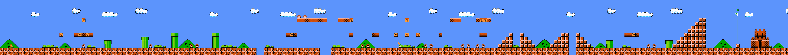
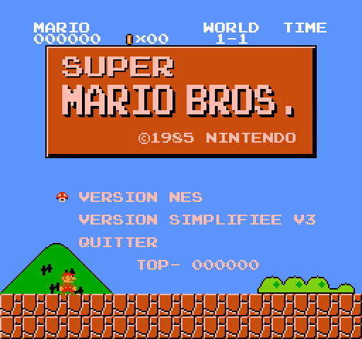
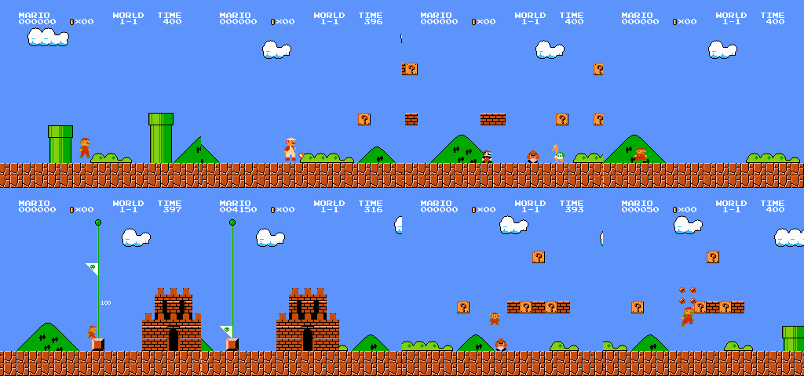
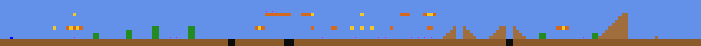
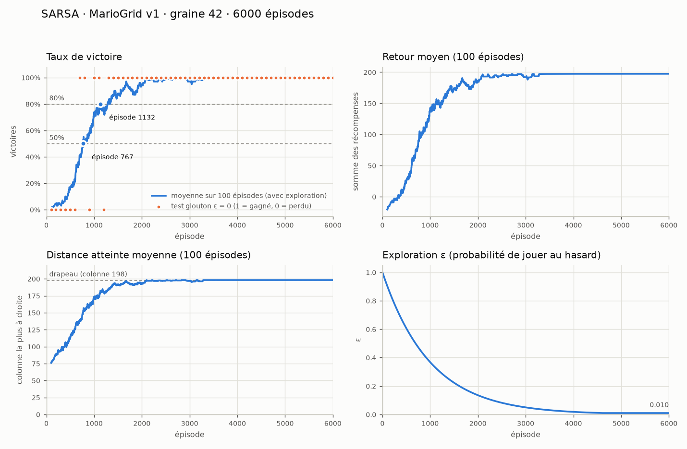

# Super Mario Bros. — Niveau 1-1 (NES) pour l'apprentissage par renforcement

Projet de groupe *Reinforcement Learning* : veille scientifique de l'article
**« Reinforcement Learning in Super Mario Bros: Curriculum, Pedagogy, and Optimal
Level Design in World 1-1 »** (Ponnock & Ho, 2026).

Ce dépôt contient :

1. **Une copie jouable du niveau 1-1** de Super Mario Bros. (NES, 1985), avec la
   physique d'origine au sous-pixel près, tous les blocs, ennemis, power-ups,
   la salle bonus, le drapeau et le château.
2. **Deux environnements Gymnasium** prêts pour le RL, sur les mêmes données de
   niveau :
   * `MarioGrid-v0` — l'environnement **discret de l'article** (grille 212 × 14,
     3 actions, arc de saut fixe, versions v1 / v2 / v3, segments A–F pour le
     curriculum). Idéal pour Q-Learning, SARSA et Monte Carlo tabulaires.
   * `MarioNES-v0` — le **vrai jeu** (60 images/s) avec observations au choix
     (grille de tuiles, vecteur, pixels, format de l'article). Idéal pour DQN.
3. **Nos agents** (dossier `agents/`) : Q-Learning et SARSA tabulaires,
   entraînés avec `train.py` ; les modèles entraînés se regardent
   jouer depuis le menu **MODELES** du jeu (section 7).



---

## 1. Installation (Windows, macOS, Linux)

Python ≥ 3.9 requis.

```bash
# dans le dossier du projet
python -m venv .venv
# Windows :        .venv\Scripts\activate
# macOS / Linux :  source .venv/bin/activate
pip install -r requirements.txt
```

Dépendances : `numpy`, `gymnasium`, `pygame-ce` (affichage/clavier seulement),
`matplotlib` (courbes d'apprentissage), `pytest` (tests). Le moteur et les environnements fonctionnent **sans pygame**
(mode sans affichage pour l'entraînement).

Vérification : `python -m pytest` (73 tests, quelques secondes).

---

## 2. Jouer

```bash
python play.py                    # écran titre (menu)
python play.py --no-menu          # lancer directement la version NES
python play.py --grid v3          # lancer directement la version simplifiée
python play.py --status fire      # commencer en Mario de feu
python play.py --no-enemies       # sans ennemis
python play.py --segments FEDCBA  # segments A-F dans l'ordre inverse
python play.py --nes-timer        # chrono d'origine (1 unité = 0,4 s)
python play.py --nes-camera       # caméra d'origine (ne revient pas en arrière)
python play.py --fullscreen       # plein écran
python play.py --help
```

**Plein écran** : option `--fullscreen`, ou **F11** / **Cmd+F** (Mac) /
**Ctrl+F** à tout moment pour basculer. L'image garde les proportions de
l'écran NES (bandes noires sur les côtés).

**Écran titre.** Le jeu s'ouvre sur l'écran titre de Super Mario Bros. :
début du niveau 1-1 en fond, HUD, panneau « SUPER MARIO BROS. ©1985
NINTENDO », curseur champignon et meilleur score (« TOP- »). Les deux options
d'origine (1 / 2 PLAYER GAME) sont remplacées par :

* **VERSION NES** : le vrai jeu ;
* **VERSION SIMPLIFIEE V3** : l'environnement discret de l'article, jouable
  (← → sur cette ligne pour choisir V1, V2 ou V3) ;
* **MODELES** : les algorithmes (Q-Learning, SARSA, Monte Carlo, DQN), puis
  les agents entraînés de chacun (dossier `models/`) ; Entrée sur un modèle
  pour le **regarder jouer en direct** (section 7) ;
* **QUITTER**.

Comme sur la NES, **SELECT** (Tab, ou ↑ / ↓) déplace le champignon et
**START** (Entrée) valide. En jeu, **Échap** ramène à l'écran titre, comme
après un GAME OVER.



Par défaut, `play.py` affiche un chrono en **vraies secondes** et la caméra
**suit Mario vers la gauche**. Sur la NES, une unité du chrono dure 24 images
(≈ 0,4 s) et l'écran ne revient jamais en arrière : les options `--nes-timer`
et `--nes-camera` rétablissent ce comportement. Les environnements RL gardent
le comportement NES par défaut ; on peut le changer avec
`gym.make("MarioNES-v0", timer_frames=60, scroll_back=True)`.

| Action | Clavier | Manette |
|---|---|---|
| Gauche / droite | ← → (ou Q/A, D) | croix / stick |
| Baisser (entrer dans un tuyau, s'accroupir) | ↓ (ou S) | croix bas |
| Sauter (bouton A) | X, K ou Espace | bouton 0 |
| Courir / boule de feu (bouton B) | C, J, Z ou Maj | bouton 1 / 2 |
| Pause (START) | Entrée ou P | Start |
| SELECT (écran titre) | Tab, ↑ / ↓ | Select, croix |
| Retour à l'écran titre | Échap | |
| Plein écran / fenêtre | F11, Cmd+F ou Ctrl+F | |

Version simplifiée : → avance d'une case, X/Espace saute, rien = rester sur
place (un pas toutes les 8 images) ; le HUD affiche le retour cumulé, la
version et le nombre de pas. À la fin : « THANK YOU MARIO! » (drapeau),
« GAME OVER » (mort) ou « TIME UP » (1000 pas), puis retour à l'écran titre.

**Astuces (comme dans le jeu original)**
* **Salle bonus** : montez sur le **4ᵉ tuyau** (colonne 57, le deuxième grand
  tuyau, juste avant le premier trou), placez-vous **bien au milieu** et
  appuyez sur **↓ sans toucher ← ou →**. Les deux pieds de Mario doivent être
  sur le haut du tuyau (fenêtre de 9 pixels, comme sur NES). Dans la salle,
  ramassez les pièces, descendez à droite du bloc de briques et avancez dans
  le **tuyau horizontal en bas à droite** : Mario ressort par le tuyau de la
  colonne 163, juste après les escaliers.
* **Haut du drapeau (5000 points)** : il faut arriver sur la dernière marche
  de l'escalier final **à pleine vitesse** (B maintenu) et sauter **au tout
  dernier moment** en gardant A enfoncé. Un saut un peu trop tôt donne 2000
  points ; en marchant, on retombe avant le mât.



---

## 3. Fidélité au jeu original

### Reproduit à l'identique
* **Carte** : 212 colonnes ; trous en 69-70, 86-88 et 153-154 ; tuyaux en
  28 / 38 / 46 / 57 / 163 / 179 (hauteurs 2 / 3 / 4 / 4 / 2 / 2) ; les 13 blocs
  « ? » (dont 3 power-ups), les briques, la brique à pièces multiples (col. 94),
  la brique à étoile (col. 101), le bloc 1-UP caché (col. 64), les 4 escaliers
  et le grand escalier final (col. 181-189), le mât (col. 198, soit 8 cases
  vides après la dernière marche) et le château (col. 202). Les colonnes sont
  identiques à celles de la figure 2 de l'article.
* **Vérifié contre les données du jeu** : `tests/test_original_data.py`
  décode les données d'origine du niveau (`L_GroundArea6` et `E_GroundArea6`
  du désassemblage de Super Mario Bros.) et vérifie que la carte est
  identique case par case, et que les ennemis le sont objet par objet.
* **Ennemis** : 16 Goombas et 1 Koopa Troopa vert, chargés comme dans le jeu :
  un objet par image quand sa colonne arrive à 48 px du bord droit de
  l'écran, 5 emplacements d'ennemis au maximum ; les 6 **groupes de deux
  Goombas** apparaissent au bord droit de l'écran (espacés de 24 px), donc
  environ 3 colonnes avant la colonne des données, là où les montrent les
  cartes. Vitesse 0,5 px/image (1/3 de la marche de Mario), chute dans les
  trous, demi-tour contre les murs et entre eux.
* **Physique du joueur** reprise des routines du jeu (`PlayerPhysicsSub`,
  `ImposeFriction`, `MoveObjectHorizontally`, `ImposeGravity`,
  `PlayerBGCollision`, `ImpedePlayerMove`, `ScrollHandler`) avec la même
  arithmétique en virgule fixe : marche 1,5 px/image, course 2,5 px/image,
  accélérations 0x98 / 0xE4, dérapage, 5 profils de saut selon la vitesse
  (gravité réduite tant que A est tenu), vitesse de chute max 4 px/image,
  points de collision tête / pieds / côtés, rebond après écrasement…
* **Mécaniques** : petit / grand / Mario de feu (≤ 2 boules de feu), étoile
  (≈ 12 s), champignon 1-UP, invincibilité après un coup, pièces (100 = 1 vie),
  score (chaînes 100 → 8000 → 1-UP), carapace à frapper, chrono de 400 (1 unité
  = 24 images), drapeau (5000 / 2000 / 800 / 400 / 100 selon la hauteur),
  décompte du temps, feux d'artifice (chiffre 1, 3 ou 6), 3 vies, point de
  reprise à mi-parcours, écran « WORLD 1-1 » et « GAME OVER ».
* **Salle bonus** par le tuyau 57 (↓ dessus), 19 pièces, sortie par le tuyau 163.
* **Décor** : collines, buissons et nuages qui se répètent toutes les 48
  colonnes, palette NES.

### Différences connues (à mentionner dans le rapport)
* Les **sprites sont redessinés** pixel par pixel (aucun fichier ni ROM Nintendo
  n'est utilisé) : l'aspect est très proche mais pas strictement identique.
* **Pas de son ni de musique**.
* L'agencement exact de la **salle bonus** (non vérifié contre les données du
  jeu, contrairement au reste du niveau) et quelques constantes secondaires
  (hauteur du rebond de l'étoile, vitesse du drapeau, durées d'animation) sont
  reconstitués et peuvent différer légèrement de l'original.
* Après le château, le niveau **recommence** (1-2 n'existe pas).
* Dans `play.py` uniquement, le chrono en secondes réelles et la caméra qui
  revient en arrière sont des ajouts (désactivables, voir section 2).

---

## 4. Environnement de l'article : `MarioGrid-v0`

```python
import gymnasium as gym
import mario_env                      # enregistre les environnements

env = gym.make("MarioGrid-v0", level="v3")   # "v1", "v2" ou "v3"
obs, info = env.reset()
obs, reward, terminated, truncated, info = env.step(1)   # 0 rien, 1 droite, 2 saut
```

| Élément | Valeur (section 2 de l'article) |
|---|---|
| Grille | 212 × 14, rangée 0 en haut, sol en rangées 12-13, départ (col 3, rang 11) |
| Actions | 0 = rester, 1 = droite, 2 = saut (au sol seulement) |
| Saut | arc fixe de 6 phases : −2, −3, −4, −4, −3, −2 cases ; droite reste possible en l'air |
| v1 | `(col, row, jump_phase)` → 3 valeurs |
| v2 | + viewport : codes des rangées 4 et 8 sur 28 colonnes → 59 valeurs |
| v3 | + rangées ennemis 7 et 11 (GOOMBA = 7) → 115 valeurs |
| Récompenses | +100 drapeau (col 198), −50 mort, +0,5 par case vers la droite, −0,1 à l'arrêt, +1 brique, +3 bloc ?, +5 ennemi écrasé |
| Ennemis (v3) | 17, 1 case tous les 3 pas, gravité, activation par groupe, écrasement |

Codes de la viewport : 0 vide, 1 sol, 2 marche d'escalier, 3 tuyau, 4 brique,
5 bloc ?, 6 bloc vide, 7 Goomba, 8 mât.

**Choix d'interprétation** (l'article ne les précise pas ; tous réglables) :
* après l'arc (ou si un bloc est touché), Mario tombe d'une case par pas ;
* après un écrasement, Mario rebondit de 2 cases ;
* un groupe d'ennemis s'active quand Mario est à ≤ 14 colonnes
  (`activation_distance`) ;
* les briques se cassent même si Mario est petit (tableau 2 : « Break brick
  block +1 ») ;
* la marche d'escalier sous le mât compte comme contact avec le drapeau ;
* épisode tronqué à 1000 pas (`max_steps`) ;
* le texte de l'article place les ennemis en rangées 7 et 11, mais la figure 2
  met les deux Goombas des briques hautes en rangée 3 : `enemy_rows=(3, 11)`
  les rend visibles.

Paramètres utiles : `reward={...}` (pondérations, voir `RewardConfig`),
`max_steps`, `viewport`, `block_rows`, `enemy_rows`, `enemy_period`,
`activation_distance`, `jump_offsets`, `segment_order`, `render_mode`
(`"human"` ou `"rgb_array"`).

### Curriculum (segments A–F, section 2.3.4)

```python
from mario_env.curriculum import PAPER_CONDITIONS   # canonical, reversed, random_200..209
env = gym.make("MarioGrid-v0", level="v3", segment_order="FEDCBA")
env.reset(options={"segment_order": "BECDFA"})       # changer d'ordre entre deux épisodes
```

Segments : A = col 0-27 (intro), B = 28-68 (tuyaux), C = 69-89 (trous + blocs),
D = 90-133 (« enemy gauntlet »), E = 134-162 (escaliers), F = 163-197 (approche
finale). Le mât reste en 198 et 3 cases sont dégagées au départ.
`PAPER_MAP_3` (`BECDFA`) et `PAPER_MAP_6` (`BEDCFA`) sont les deux cartes citées
dans l'article. L'article ne précise pas le générateur de ses graines 200-209 :
nos permutations aléatoires ne sont donc pas forcément les mêmes.



---

## 5. Vrai jeu : `MarioNES-v0`

```python
env = gym.make("MarioNES-v0",
               obs_type="tiles",      # "tiles" | "vector" | "rgb" | "paper"
               actions="simple",      # "right_only" | "simple" | "complex" | "paper" | liste
               frame_skip=4,          # images NES par pas (action maintenue)
               level="full",          # "v1" | "v2" | "v3" | "full"
               reward="paper")        # "paper" | "progress" | "score" | dict | fonction
```

**Observations**
* `tiles` (défaut) : grille `uint8` 13 × 16 de l'écran (ou autour de Mario avec
  `tile_view="mario"`, `view_cols=(4, 12)`). Codes : 0 vide, 1 solide, 2 brique,
  3 bloc ?, 4 pièce, 5 ennemi, 6 carapace, 7 objet bonus, 8 Mario, 9 mât,
  10 boule de feu.
* `vector` : 62 réels (position, vitesses, état, 5 ennemis les plus proches,
  profil du terrain sur 16 colonnes) — pour un DQN à MLP.
* `rgb` : image 240 × 256 × 3, réductible (`rgb_size=(84, 84)`,
  `grayscale=True`) — pour un DQN convolutif.
* `paper` : même format que v3 de l'article (colonne, rangée, phase
  sol/montée/chute, viewport) → comparaison directe tabulaire vs vrai jeu.

**Actions** : `paper` = [rien, droite, A] ; `right_only` = [rien, →, →A, →B,
→AB] ; `simple` = right_only + [A, ←] ; `complex` = simple + [←A, ←B, ←AB, ↓, ↑].

**Récompense** : `RewardConfig` (tableau 2 de l'article par défaut) :
`progress_per_tile`, `stand_still`, `win`, `death`, `brick`, `qblock`, `enemy`,
`coin`, `powerup`, `one_up`, `score_scale`, `time_penalty`, `clip`. Le préréglage
`"progress"` reproduit gym-super-mario-bros (Δx − temps − mort, borné à ±15).
Toute fonction `f(prev_info, info) -> float` est acceptée.

**`info`** : `x`, `y`, `x_pos`, `col`, `row`, `status`, `on_ground`, `score`,
`coins`, `time`, `flag_get`, `dead`, `death_cause`, `stats` (briques, blocs ?,
ennemis, sauts…).

**Autres options** : `lives` (1 par défaut : fin d'épisode à la première mort),
`start_status`, `segment_order`, `max_episode_steps`, `terminate_on_flag`,
`noop_max` (départ aléatoire), `timer`, `render_mode="human"` (fenêtre à
60 images/s) ou `"rgb_array"`, `reset(options={"start_col": 100})` (départ plus
loin dans le niveau), `env.unwrapped.clone_state()` / `restore_state()`.

---

## 6. Conseils pour la partie RL

* **Tabulaire (Q-Learning, SARSA, Monte Carlo)** : `MarioGrid-v0` (identique à
  l'article), ou `MarioNES-v0` avec `obs_type="paper", actions="paper"`. Les
  observations sont des tableaux d'entiers ; `mario_env.state_key(obs)` donne un
  tuple utilisable comme clé d'un `dict` / `defaultdict`.
* **DQN** : `MarioNES-v0` avec `obs_type="tiles"` (le plus léger), `"vector"`
  ou `"rgb"`, ou `MarioGrid-v0` (entrée de taille 115 comme dans l'article).
* **Graines** : `env.reset(seed=...)` ; les deux moteurs sont déterministes
  (l'aléatoire vient de l'agent ou de `noop_max`).
* **Plusieurs environnements en parallèle** :

```python
import gymnasium as gym
import mario_env

def make():
    return gym.make("MarioNES-v0", obs_type="tiles")

if __name__ == "__main__":          # obligatoire sous Windows / macOS
    envs = gym.vector.AsyncVectorEnv([make for _ in range(8)])
```

* **Visualiser un agent** : `gym.make(..., render_mode="human")`, ou
  `render_mode="rgb_array"` pour enregistrer des vidéos.
* Boucle minimale (agent aléatoire) :

```python
env = gym.make("MarioGrid-v0", level="v3")
obs, info = env.reset(seed=42)
done = False
while not done:
    obs, r, terminated, truncated, info = env.step(env.action_space.sample())
    done = terminated or truncated
print(info["win"], info["total_reward"])
```

### Performances (1 cœur, actions aléatoires, `python scripts/benchmark.py`)

| Environnement | Pas / seconde |
|---|---|
| `MarioGrid-v0` v1 / v2 / v3 | ≈ 160 000 / 140 000 / 60 000 |
| `MarioNES-v0` tiles (frame_skip 4) | ≈ 15 000 |
| `MarioNES-v0` paper / vector | ≈ 12 000 / 10 000 |
| `MarioNES-v0` rgb 84×84 | ≈ 1 600 |
| Moteur NES seul | ≈ 150 000 images/s |

Mesures sur la machine de développement. À titre indicatif, les 10 000 épisodes
d'un run de l'article (v3) demandent de l'ordre d'une minute de simulation avec
`MarioGrid-v0` (sans compter le temps de calcul de l'agent).

---

## 7. Nos agents : Q-Learning et SARSA

### Lancer un entraînement

```bash
python train.py --algo qlearning --level v1 --episodes 10000 --seeds 42
python train.py --algo sarsa --level v1 --episodes 6000 --seeds 42
python train.py --algo sarsa --level v3 --episodes 10000 --seeds 42 43 44 45 46
python train.py --help        # tous les réglages
```

(`python train_qlearning.py ...` reste un raccourci pour `--algo qlearning`.)

**Les deux algorithmes** utilisent la même Q-table et le même ε-greedy ; seule
la cible de la mise à jour change :

* **Q-Learning** (`agents/qlearning.py`) : cible = r + γ × note du *meilleur*
  bouton dans la situation suivante (il suppose qu'il jouera parfaitement) ;
* **SARSA** (`agents/sarsa.py`) : cible = r + γ × note du bouton qu'il va
  *vraiment* jouer ensuite, hasard compris. Il tient donc compte de ses
  propres erreurs d'exploration et apprend des chemins plus prudents.

Réglages par défaut = ceux de l'article (section 2.2), identiques pour les
deux : α = 0,1 ; γ = 0,99 ;
ε part de 1, est multiplié par 0,999 après chaque épisode, plancher 0,01
(atteint à l'épisode 4604) ;
Q-table initialisée à 0 ; égalités départagées au hasard ; récompenses du
tableau 2 ; 1000 pas maximum par épisode. Plusieurs graines tournent **en
parallèle** (une par cœur du processeur) et le script affiche alors la
moyenne ± l'écart-type, comme le tableau 3 de l'article.

Chaque graine crée un dossier `models/<algo>_<version>_s<graine>_<épisodes>ep/` :

| Fichier | Contenu |
|---|---|
| `meta.json` | réglages, mesures de l'article, test glouton, durée |
| `qtable.npz` | la Q-table (une ligne par état : l'état et ses 3 valeurs) |
| `history.csv` | une ligne par épisode (retour, victoire, mort, pas, colonne atteinte, ε…) — à ouvrir dans Excel / pandas |
| `curves.png` | courbes : taux de victoire, retour, distance, ε |

Un modèle du même nom n'est pas écrasé (suffixe `_2`, `_3`…) sauf avec
`--overwrite`.

**Mesures affichées** (section 2.3.3 de l'article) : taux de victoire et
retour moyen sur les 500 derniers épisodes, épisodes pour atteindre 50 % et
80 % de victoires (moyenne glissante sur 100 épisodes), et en v2/v3 briques,
blocs ? et ennemis par épisode. En plus : un **test glouton** (une partie avec
ε = 0, sans apprendre) tous les 100 épisodes et à la fin — il montre ce que
l'agent a réellement retenu, sans le bruit de l'exploration.

### Regarder un modèle jouer

`python play.py` → **MODELES** → choisir l'algorithme (Q-LEARNING, SARSA,
MONTE CARLO, DQN) → Entrée sur un modèle. L'agent joue sa
politique gloutonne (ε = 0) à 7,5 pas/s ; **→ / ←** accélère / ralentit
(x1, x2, x4, x8), **Échap** revient à la liste. En fin de partie, retour
automatique à la liste. La partie affichée est exactement celle du test
glouton final.

### Nos résultats (graine 42)

| Algorithme | Niveau | Épisodes | Victoires (500 dern.) | Retour moyen | → 50 % | → 80 % | Test glouton |
|---|---|---|---|---|---|---|---|
| Q-Learning | v1 | 10 000 | 99,2 % | 195,5 | 976 | 1368 | gagné, 234 pas |
| Q-Learning | v2 | 10 000 | 99,2 % | 213,2 | 1080 | 1712 | gagné, 241 pas |
| Q-Learning | v3 | 10 000 | 93,0 % | 241,0 | 2808 | 3468 | gagné, 275 pas |
| SARSA | v1 | 6 000 | 100,0 % | 197,4 | 767 | 1132 | gagné, 223 pas |

Article (5 graines, 10 000 épisodes) : Q-Learning v1 98,8 % / 191,7 / 1345 /
2122 ; v2 98,9 % / 205,5 / 1241 / 1964 ; v3 86,5 % / 173,3 / 3157 / 4029 ;
SARSA v1 100,0 % / 193,9 / 1054 / 1553. Une seule graine pour l'instant :
pas encore d'écart-type.



### Utiliser l'agent dans son propre code

```python
from agents import TrainConfig, train, load_agent
agent, history, tests, final, seconds = train(
    TrainConfig(algo="sarsa", level="v2", episodes=2000, seed=42))
agent = load_agent("models/qlearning_v1_s42_3000ep")   # recharger un modèle
```

---

## 8. Organisation du code

```
mario_env/
  constants.py     constantes NES (physique, tuiles, palette, codes d'observation)
  level_data.py    carte de 1-1, ennemis, décor, salle bonus, segments A-F
  game.py          moteur fidèle au NES (une image = Game.step(boutons))
  entities.py      joueur, ennemis, objets, boules de feu, effets
  sprites.py       graphismes redessinés (pixel-art) + police du HUD
  renderer.py      rendu numpy 256×240 (sans pygame)
  play.py          jeu au clavier / manette (pygame)
  curriculum.py    conditions de l'expérience de curriculum
  envs/
    grid_env.py    MarioGrid-v0 (environnement de l'article)
    nes_env.py     MarioNES-v0 (vrai jeu)
    common.py      jeux d'actions, récompenses, codes
agents/
  qlearning.py     agent Q-Learning (Q-table, epsilon-greedy, mise à jour)
  sarsa.py         agent SARSA (même Q-table, autre mise à jour)
  training.py      boucle d'entraînement et test glouton
  metrics.py       mesures de l'article et courbes
  registry.py      sauvegarde / liste des modèles (dossier models/)
models/            modèles entraînés (lus par le menu MODELES)
train.py           lancer un entraînement (--algo qlearning ou sarsa)
train_qlearning.py raccourci pour train.py --algo qlearning
scripts/           benchmark.py, export_images.py (figures pour le rapport)
tests/             tests automatiques (pytest)
docs/              images du README
```

Utiliser le moteur directement :

```python
from mario_env import Game, GameConfig
from mario_env.constants import BTN_RIGHT, BTN_A, BTN_B
g = Game(GameConfig(lives=1))
g.step(BTN_RIGHT | BTN_B)          # une image
print(g.info())
```

---

*Projet éducatif (dépôt privé, non distribué). Super Mario Bros. est une marque
de Nintendo ; aucun élément original du jeu (ROM, sprites, sons) n'est inclus.*
